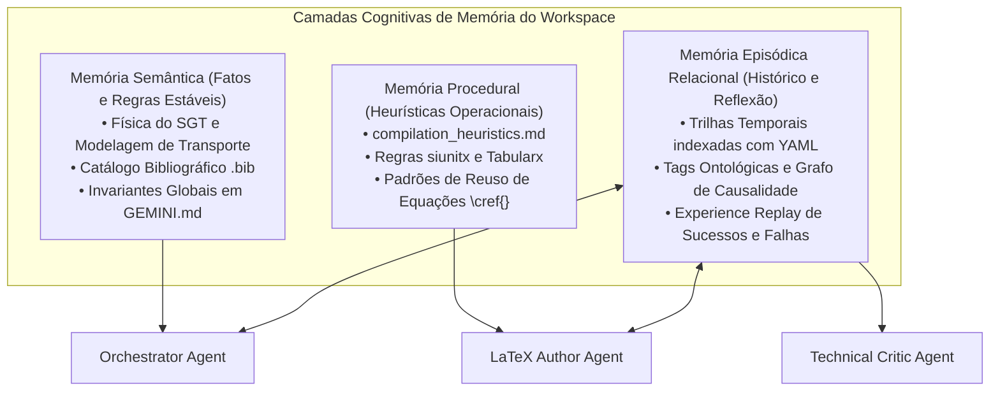
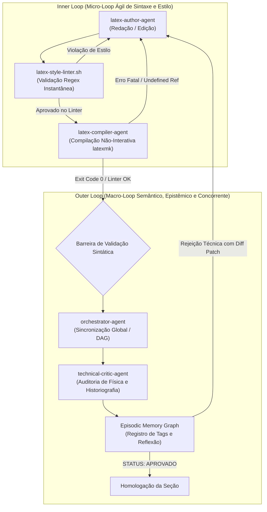

# Plano Retrospectivo de Arquitetura de IA e Reestruturação Definitiva do Workspace

**Documento:** `utils/memory/ai_setup_retrospective_plan.md`  
**Autor:** Principal AI Systems Architect, Meta-Agent Engineer e Lead Workflow Auditor  
**Data:** 11 de outubro de 2026  
**Finalidade:** Diagnóstico retrospectivo das causas-raiz de atrito no desenvolvimento do artigo acadêmico sobre Federico Faggin e o Intel 4004, com especificação técnica completa de:
1. Matriz de atrito histórico e lições aprendidas;
2. Patches para diretrizes mestras (`GEMINI.md`);
3. Patches para prompts dos agentes (`.agents/agents/*.md`);
4. Guardrails e hooks preventivos (`.agents/hooks/`);
5. **Arquitetura de Memória Cognitiva Tripartite e Episódica Relacional com Tags e Grafos de Feedback**;
6. **Redesenho dos Loops de Execução: Topologia Hierárquica em Dois Níveis (*Hierarchical Dual-Loop*) e Loops Especializados por Agente**;
7. Roteiro sequencial de implementação.

---

## 1. Sumário Executivo e Matriz de Atrito Histórico

Ao longo do desenvolvimento do manuscrito acadêmico, o workspace operou com base em uma esteira multiagente que alcançou o objetivo final (artigo de 13 páginas, matematicamente rigoroso, com 0 advertências de compilação e aprovado pelo revisor técnico). Contudo, a análise da trajetória revela que o sistema despendeu ciclos excessivos de correção manual provocados por deficiências arquiteturais do setup inicial.

A matriz abaixo mapeia os cinco atritos sistemáticos identificados, suas causas-raiz e as soluções definitivas propostas:

| ID | Sintoma / Atrito Observado | Causa-Raiz na Arquitetura Original | Solução Estrutural Definitiva |
| :---: | :--- | :--- | :--- |
| **A-01** | **Vícios de Redação de IA:** Surgimento sistemático de `\textbf{}` no corpo do texto, ponto e vírgula (`;`), travessões e jargões retóricos (*"alta heterogeneidade topológica"*). | As instruções negativas estavam dispersas e dependiam da memória de trabalho do modelo, sem linters sintáticos determinísticos pré-compilação. | **Linter Preventivo Local:** Hook Bash/Regex (`latex-style-linter.sh`) que bloqueia o commit ou valida o arquivo em milissegundos antes da invocação do compilador e revisor. |
| **A-02** | **Silos Cognitivos e Redundância Matemática:** O redator re-deduziu na Seção IV nove equações já formalizadas na Seção II, inflando o artigo para 15 páginas. | O `retriever-agent` e o `latex-author-agent` operavam com escopo estrito de seção, sem protocolo mandatório de *Delta Context Awareness* para referenciar equações prévias via `\cref{}`. | **Protocolo Anti-Redundância Intercapitular:** Regra global proibindo re-deduções e instruindo o `retriever` a entregar exclusivamente deltas conceituais, obrigando o autor a reusar `\cref{}`. |
| **A-03** | **Gargalo de Execução Sequencial:** O DAG inicial impunha uma esteira estritamente serial (Seção I $\rightarrow$ II $\rightarrow$ III $\rightarrow$ IV $\rightarrow$ V $\rightarrow$ VI), dilatando o tempo total de produção. | O `orchestrator-agent` não possuía playbooks nem contratos de permissão para despacho concorrente com particionamento disjunto de arquivos. | **Topologia Híbrida Serial-Paralela:** Playbook nativo no `orchestrator` para despacho de frentes paralelas concorrentes com alvos de escrita estritamente disjuntos e barreira de sincronização global. |
| **A-04** | **Ciclo Crítica-Correção Reativo e Verboso:** O revisor e o compilador operavam como auditores pós-fato emitindo relatórios dissertativos que demandavam re-interpretação pelo redator. | Falta de pré-validação sintática rápida e ausência de propostas de *patch* acionáveis nos relatórios de falha dos agentes fiscais. | **Feedback Sintético e Acionável:** Padronização dos contratos de retorno do compilador e do crítico com indicação exata de linha e sugestão direta de substituição (*diff-ready*). |
| **A-05** | **Memória Ad-Hoc e Informações Dispersas:** A pasta `utils/memory/` nasceu sem taxonomia estrita, misturando relatórios extensos com dados de telemetria operacional em Markdown plano. | Ausência de esquemas de dados relacionais e metadados estruturados para reflexão interativa entre agentes e modelos rápidos (`flash`). | **Arquitetura Cognitiva Tripartite com Tags e Relações:** Estruturação em camadas Semântica, Procedural e Episódica Relacional (YAML frontmatter + tags ontológicas + grafos de causalidade). |

---

## 2. Fundamentação Teórica: Arquitetura Cognitiva de Memória Multiagente

Com base nas pesquisas contemporâneas em sistemas cognitivos de inteligência artificial (LangGraph, MemGPT/Letta, Reflexion de Shinn et al., AutoGen e sistemas de memória episódica com grafos), a gestão de memória em produção acadêmica não pode ser tratada como um mero repositório de arquivos Markdown estáticos. Ela exige a diferenciação explícita de três camadas funcionais de memória:



### 2.1 Camada 1: Memória Semântica (Semantic Memory)
Representa o conhecimento factual consolidado, as regras de domínio e os parâmetros invariantes do projeto:
- **Conteúdo:** Modelos matemáticos de semicondutores ($C_{ox}$, $C_{ov}$, $\tau_{pd}$, $V_{th}$), dados históricos documentados de Federico Faggin, patentes indexadas, integridade com `pos_textuais/01_referencias.bib` e restrições editoriais inegociáveis.
- **Ciclo de Vida:** Estável e de leitura universal por todos os agentes. Não sofre mutações pelas iterações de escrita; serve como verdade de referência (*ground truth*).

### 2.2 Camada 2: Memória Procedural (Procedural Memory)
Representa o conhecimento operacional sobre "como executar tarefas técnicas com sucesso":
- **Conteúdo:** Heurísticas de compilação em `utils/memory/compilation_heuristics.md` (escape de sublinhados em caminhos de imagem, formatação de unidades no `siunitx`, tratamento de *overfull \hbox* em tabelas de duas colunas, estratégias de escrita fluida sem ponto e vírgula).
- **Ciclo de Vida:** Evolui incrementalmente conforme os compiladores e linters detectam novos padrões de erro e registram suas respectivas soluções.

### 2.3 Camada 3: Memória Episódica Relacional (Relational Episodic Memory)
Representa a trilha histórica explícita de eventos, decisões, execuções e avaliações ocorridas ao longo das iterações:
- **Conteúdo:** Registro de cada ciclo de produção de seção, contendo o autor da modificação, o código do erro do compilador, a crítica do revisor técnico, o *diff* gerado e o desfecho final (*success*, *rejected*, *rollbacked*).
- **Inovação Estrutural:** Cada episódio deixa de ser texto livre e passa a conter metadados estruturados em YAML (*frontmatter*) com **tags ontológicas** e **arestas de causalidade bidirecionais** (ex.: `depends_on`, `supersedes`, `addressed_by`, `refutes`), formando um grafo de conhecimento histórico da evolução textual.

---

## 3. Especificação do Sistema de Memória Episódica Relacional

### 3.1 Esquema de Metadados YAML Frontmatter

Todos os arquivos de histórico e registros de iteração em `utils/memory/episodes/` passam a adotar o seguinte esquema canônico:

```yaml
---
entry_id: "ep_sec04_iter01_rev"
timestamp: "2026-10-11T21:00:00Z"
agent_id: "technical-critic-agent"
section_target: "secoes/04_resultados.tex"
iteration_cycle: 1
outcome: "rejected"
severity: "critical"
confidence_score: 0.95

tags:
  - "#domain/physics/semiconductors"
  - "#flaw/cross-section-redundancy"
  - "#flaw/equation-duplication"
  - "#typography/clean"

relations:
  references_eq:
    - "eq:cox"
    - "eq:cov"
    - "eq:vth_expandido"
  supersedes: null
  superseded_by: "ep_sec04_iter02_fix"
  conflicts_with: []
  addressed_by: "patch_editorial_sec04"

metrics:
  word_count_delta: -250
  compilation_exit_code: 0
  overfull_hbox_count: 0
---
# Diagnóstico Técnico
O rascunho da Seção IV re-deduziu analiticamente as equações de C_ox, C_ov e V_th,
duplicando o desenvolvimento formal já estabelecido na Seção II.

## Ação Corretiva Obrigatória
Substituir os blocos displaymath por referências diretas \cref{eq:cox}, \cref{eq:cov}
e \cref{eq:vth_expandido}, concentrando o texto na aplicação paramétrica aos 2300 transistores.
```

### 3.2 Vocabulário Controlado de Tags Ontológicas

Para garantir indexação semântica e recuperação determinística por modelos rápidos (`flash`), adota-se uma taxonomia em quatro eixos:

1. **Eixo de Domínio (`#domain/...`):**
   - `#domain/physics/capacitance`: Capacitâncias parasitas, efeito Miller e atrasos transitórios.
   - `#domain/physics/threshold`: Tensão de limiar, função trabalho e cargas de interface.
   - `#domain/physics/materials`: Termodinâmica de polissilício, *spiking* e captura iônica ($\text{POCl}_3$).
   - `#domain/history/faggin-lineage`: Atribuição historiográfica do 4004, 8008, 8080 e Z80.
   - `#domain/socioeconomics`: Sistemas embarcados, robótica industrial e automação fabril.

2. **Eixo de Falhas e Desvios (`#flaw/...`):**
   - `#flaw/equation-duplication`: Re-dedução matemática já presente em capítulo anterior.
   - `#flaw/style/bold-inline`: Emprego de `\textbf{}` no corpo do parágrafo ou listas.
   - `#flaw/style/semicolon`: Presença de ponto e vírgula na prosa.
   - `#flaw/style/em-dash`: Presença de travessões parentéticos.
   - `#flaw/style/ai-jargon`: Emprego de academicismos vazios ou clichês de IA.
   - `#flaw/style/list-addiction`: Fragmentação indevida da narrativa em tópicos.

3. **Eixo de Ações e Correções (`#fix/...`):**
   - `#fix/cross-ref-delta`: Substituição de equação duplicada por `\cref{}`.
   - `#fix/prose-cohesion`: Fusão de períodos em parágrafo contínuo.
   - `#fix/sobriety-rewrite`: Substituição de adjetivos superlativos por causalidade direta.

4. **Eixo de Integridade do Build (`#build/...`):**
   - `#build/exit-0`: Compilação limpa sem erros.
   - `#build/undefined-ref`: Referência cruzada inexistente.
   - `#build/undefined-cite`: Chave bibliográfica órfã.
   - `#build/overfull-box`: Extravasamento de margem tipográfica.

### 3.3 Protocolo de Consulta e Reflexão (Experience Replay)

Antes de redigir ou arbitrar qualquer seção, o agente executa a rotina de reflexão causal:

```
ALGORITMO Experience_Replay_Query:
1. ENTRADA: section_target, target_tags
2. FILTRAR utils/memory/episodes/*.md ONDE:
     (section_target == alvo OU tags INTERSECTA target_tags) E (outcome == 'rejected')
3. RECUPERAR as arestas 'addressed_by' e as lições aprendidas registradas
4. SINTETIZAR a lista de armadilhas a evitar antes da geração do código LaTeX
5. INICIAR redação com as restrições já internalizadas
```

Com esse protocolo, o `latex-author-agent` nunca tenta redigir a Seção IV sem carregar a memória episódica de que "duplicações matemáticas na Seção IV foram rejeitadas com severidade crítica", assegurando convergência imediata no ciclo 1 (*zero-shot convergence*).

### 3.4 Poda e Curadoria Temporal da Memória (Memory Curation & Pruning)

Para prevenir explosão de tokens de contexto:
- **Consolidação de Ciclos Bem-Sucedidos:** Quando uma seção é homologada (`STATUS: APROVADO`), seus episódios intermediários de rascunho são consolidados em um único arquivo de síntese episódica (`episode_consolidated_secXX.md`).
- **Poda de Diffs Brutos:** Versões rejeitadas arquivam apenas a tupla causal `[falha, tag, correção_aplicada]`, purgando blocos de código redundantes.
- **Cache Ativo:** Apenas os últimos três episódios relevantes de cada seção permanecem no conjunto de trabalho de leitura ativa dos agentes.

---

## 4. Redesenho dos Loops de Execução: Topologia Hierárquica em Dois Níveis (*Hierarchical Dual-Loop*)

### 4.1 Diagnóstico Crítico do Loop Monolítico Linear Atual

O modelo original implementado no início do projeto utilizava um loop serial monolítico:

$$\text{Retriever} \longrightarrow \text{Author} \longrightarrow \text{Compiler} \longrightarrow \text{Critic} \longrightarrow \text{Decision (Aprove / Rollback)}$$

**Deficiências Estruturais Detectadas:**
1. **Acoplamento Ineficiente:** O `technical-critic-agent` (que consome o modelo mais caro e lento, `pro`) era frequentemente disparado para avaliar textos que ainda continham falhas triviais de sintaxe LaTeX ou pequenas violações estilísticas (como um ponto e vírgula remanescente).
2. **Latência Multiplicativa:** Qualquer ajuste cosmético de formatação exigia o acionamento de toda a cadeia de quatro agentes.
3. **Rigidez Serial:** Impedia que seções com independência conceitual mútua avançassem em paralelo.

### 4.2 Proposta: Topologia Hierárquica em Dois Níveis (*Hierarchical Dual-Loop*)

Propõe-se a divisão do ciclo de vida em dois loops desacoplados com diferentes frequências de disparo e papéis especializados:



#### Nível 1: Inner Loop (Micro-Loop de Construção e Sintaxe)
- **Componentes:** `latex-author-agent` + `latex-style-linter.sh` + `latex-compiler-agent`.
- **Frequência e Custo:** Altíssima velocidade, execução em segundos, modelo econômico/rápido (`flash`) no compilador e scripts Bash determinísticos.
- **Responsabilidade:** Garantir que o artefato `.tex` compile sem advertências, respeite as margens de página e atenda às regras negativas de formatação (zero `\textbf{}`, zero `;`, zero travessões).
- **Critério de Saída do Inner Loop:** Código de retorno 0 no `latexmk`, 0 referências indefinidas e aprovação formal no `latex-style-linter.sh`.
- **Isolamento:** O `technical-critic-agent` e o `orchestrator-agent` **nunca são acionados** se o Inner Loop não tiver sido 100% satisfeito.

#### Nível 2: Outer Loop (Macro-Loop Semântico e Epistêmico)
- **Componentes:** `orchestrator-agent` + `technical-critic-agent` + Memória Episódica Relacional.
- **Frequência e Custo:** Acionado exclusivamente sobre código limpo e compilado; utiliza modelos analíticos avançados (`pro`).
- **Responsabilidade:** Auditar o rigor físico dos dispositivos semicondutores, a fidelidade histórica às evidências contemporâneas, a originalidade argumentativa e a ausência de redundâncias intercapitulares.
- **Mecanismo de Reflexão:** Caso o revisor rejeite a seção, ele gera um *Actionable Diff Patch* acompanhado de tags ontológicas. Esse parecer é indexado na Memória Episódica Relacional e entregue ao `latex-author-agent`, que reinicia o Inner Loop com o *Experience Replay* carregado.

---

### 4.3 Loops Especializados por Agente

Cada um dos cinco agentes especializados do workspace passa a operar sob um ciclo interno dedicado à sua competência:

```
1. RETRIEVER-AGENT: Explore-Delta Loop
   [Demanda do Orquestrador] ──> [Consulta Memória Semântica e Seções Anteriores]
                             ──> [Extrai apenas Novidades Factual-Métricas]
                             ──> [Gera Delta Cache com \cref{} mapeados] ──> FIM

2. LATEX-AUTHOR-AGENT: Draft-Lint-Fix Micro-Loop
   [Recebe Delta Cache + Reflexão] ──> [Redige Prosa Contínua sem Redundância]
                                   ──> [Dispara Linter Local em Milissegundos]
                                   ──> (Se falhar: auto-corrige sintaxe)
                                   ──> [Dispara Compilação Local] ──> FIM

3. LATEX-COMPILER-AGENT: Batch Verification & Telemetry Loop
   [Comando latexmk em Modo Lote] ──> [Parsing Automatizado de out/main.log]
                                  ──> [Extração de Undefined Refs e Overfull]
                                  ──> [Emissão de Telemetria Estruturada YAML] ──> FIM

4. TECHNICAL-CRITIC-AGENT: Adversarial Audit & Reflexion Loop
   [Ingestão do PDF Compilado] ──> [Confronto com Rubrica de 6 Dimensões]
                                ──> [Detecção de Redundâncias Intercapitulares]
                                ──> [Geração de Registro de Reflexão com Tags e Relações]
                                ──> [Emissão de Parecer Determinístico] ──> FIM

5. ORCHESTRATOR-AGENT: Concurrent DAG & Barrier Loop
   [Particionamento Disjunto de Seções] ──> [Despacho Paralelo via invoke_subagent]
                                        ──> [Barreira de Sincronização Global]
                                        ──> [Auditoria de Repositório Git]
                                        ──> [Fechamento Global] ──> FIM
```

---

## 5. Especificação de Patches para `GEMINI.md`

O arquivo [`GEMINI.md`](file:///home/luis/ufmg/desc-eng/GEMINI.md) passa a consolidar o modelo hierárquico e o sistema de memória relacional:

```markdown
# Diretrizes do Sistema: Artigo Academico Federico Faggin e Intel 4004

## 1. Escopo do Projeto e Arquitetura do Workspace
Este workspace hospeda o desenvolvimento de um artigo academico sobre a contribuicao tecnica de Federico Faggin no desenvolvimento da tecnologia de porta autoalinhada de silicio (Silicon Gate Technology, SGT) e na viabilizacao fisica do microprocessador comercial Intel 4004. O texto examina a transicao de circuitos integrados com porta metalica de aluminio para silicio policristalino, detalha a reducao de capacitancias parasitas e analisa os reflexos dessa mudanca estrutural na integracao de sistemas em pastilha unica.

Organizacao de pastas do repositorio:
- `00_config.tex`: Declaracao de pacotes, definicao de estilos e parametros tipograficos globais.
- `main.tex`: Arquivo de entrada principal que organiza a inclusao das secoes textuais.
- `secoes/`: Arquivos `.tex` correspondentes a cada subdivisao do artigo.
- `pos_textuais/01_referencias.bib`: Catalogo de fontes bibliograficas e citacoes.
- `img/`: Vetores, esquematicos e figuras dos dispositivos semicondutores.
- `utils/memory/`: Sistema de memoria cognitiva tripartite (caches, heuristicas, auditorias e episodios relacionais).
- `utils/docs/`: Fontes documentais primarias, patentes e artigos historicos coletados.
- `out/`: Diretorio de saida isolado para artefatos gerados pelo compilador LaTeX.

## 2. Topologia Multi-Agente e Arquitetura de Loops Hierarquicos (Dual-Loop)
O desenvolvimento opera sob uma arquitetura hierarquica em dois niveis com cinco agentes especializados:
1. `orchestrator-agent` (Modelo: pro): Coordenacao do DAG global, despacho de frentes paralelas e gerenciamento do Outer Loop.
2. `retriever-agent` (Modelo: flash): Extracao de deltas conceituais e mapeamento de reuso matematico a partir de `utils/docs/`.
3. `latex-author-agent` (Modelo: pro): Redacao em prosa continua e operacao do Inner Loop de auto-correcao sintatica.
4. `latex-compiler-agent` (Modelo: flash): Compilacao nao-interativa e geracao de telemetria estruturada em `out/`.
5. `technical-critic-agent` (Modelo: pro): Auditoria adversarial de rigor fisico, historico e anti-redundancia no Outer Loop.

Dinamica dos Loops:
- **Inner Loop (Sintaxe e Estilo):** O redator itera diretamente com o linter local (`latex-style-linter.sh`) e o compilador ate zerar erros e advertencias, sem acionar o revisor senior.
- **Outer Loop (Semantica e Epistemologia):** Acionado exclusivamente sobre versoes com exit code 0 e linter aprovado, registrando licoes aprendidas na Memoria Episodica Relacional.
- **Despacho Concorrente Disjunto:** O orquestrador despacha multiplas frentes paralelas de trabalho onde cada redator opera com propriedade exclusiva de um arquivo `.tex`, sincronizando em barreira unica.

## 3. Sistema de Memoria Cognitiva Tripartite
- **Memoria Semantica:** Base de regras invariantes e catalogo canonico `pos_textuais/01_referencias.bib`.
- **Memoria Procedural:** Heuristicas operacionais em `utils/memory/compilation_heuristics.md`.
- **Memoria Episodica Relacional:** Trilhas indexadas em `utils/memory/episodes/` com frontmatter YAML, tags ontologicas hierarquicas e arestas de causalidade (`references_eq`, `supersedes`, `addressed_by`).

## 4. Governanca de Seguranca e Isolamento de Escrita
- Modificacao de arquivos `.tex` em `secoes/`: Permitida exclusivamente ao `latex-author-agent`. Em execucoes paralelas, cada agente recebe permissao restrita a um unico arquivo alvo.
- Comandos de compilacao no terminal: Permitidos exclusivamente ao `latex-compiler-agent`.
- Comandos de reversao de codigo e sincronizacao git: Restritos ao `orchestrator-agent`.
- Agentes de consulta (`retriever-agent` e `technical-critic-agent`) operam em modo estritamente de leitura.

## 5. Fluxos de Trabalho e Validacao Preventiva
- Linting estilistico preventivo (executado antes de qualquer compilacao):
  ```bash
  bash .agents/hooks/latex-style-linter.sh secoes/
  ```
- Compilacao completa do artigo:
  ```bash
  latexmk -pdf -interaction=nonstopmode -halt-on-error -outdir=out main.tex
  ```
- Auditoria de estado do repositorio:
  ```bash
  git status --porcelain
  ```

## 6. Restricoes Negativas e Invariantes Comportamentais (Tolerancia Zero)
- Proibido gerar agentes genericos que unifiquem escrita, compilacao e arbitragem.
- **Protocolo Anti-Redundancia Intercapitular:** Proibido re-deduzir ou reapresentar blocos de equacoes matematicas ja formalizados em secoes anteriores. Modelos de capacitancia, limiar e atraso introduzidos na Fundamentacao Teórica devem ser referenciados nas secoes posteriores estritamente por meio de rotulos cruzados (`\cref{eq:...}`).
- Proibido utilizar travessoes em-dash ("—"), en-dash ("–") ou ponto e virgula (";") na producao de textos em portugues.
- Proibido o uso de `\textbf{}` no corpo da prosa ou em listas. O negrito fica restrito exclusivamente a cabecalhos de tabela e comandos estruturais de secao.
- Proibido o uso de listas (itemize ou enumerate) para narrativas continuas. O texto deve ser redigido prioritariamente em prosa corrida e paragrafos coesos.
- Proibido o uso de jargoes empolados de IA e academicismos vazios (ex.: "alta heterogeneidade topologica", "filtros criticos rigorosos", "confluencia interdisciplinar", "vertices epistemicos").
- Proibido o uso de termos promocionais e superlativos sem fundamentacao fisica direta ("revolucionario", "astronomicos", "impressionante", "crucial", "divisor de aguas").
- Proibido transitar entre etapas do artigo sem parecer formal de aprovacao emitido pelo revisor.
```

---

## 6. Especificação de Patches para os Agentes (`.agents/agents/*.md`)

### 6.1 `orchestrator-agent.md`
```markdown
### Protocolo de Despacho Concorrente e Gestão do Outer Loop
1. Em tarefas multisseção, invocar subagentes em lote concorrente via `invoke_subagent`, atribuindo arquivos disjuntos.
2. Cada subagente resolve autonomamente seu Inner Loop local (autor + linter + compilador).
3. Na barreira de sincronização global, o orquestrador dispara o `latex-compiler-agent` para validação de referências cruzadas globais.
4. Sendo o build bem-sucedido, submete o artigo ao `technical-critic-agent` no Outer Loop, capturando pareceres e persistindo episódios relacionais em `utils/memory/episodes/`.
```

### 6.2 `retriever-agent.md`
```markdown
### Delta Context Awareness e Consulta à Memória Episódica
1. Antes de minerar evidências, consultar a Memória Semântica das seções precedentes em `secoes/` e os episódios em `utils/memory/episodes/`.
2. Mapear explicitamente equações já deduzidas (`references_eq`) para indicar quais devem ser reusadas via `\cref{}`.
3. Entregar ao autor exclusivamente os parâmetros empíricos e deltas documentais inéditos.
```

### 6.3 `latex-author-agent.md`
```markdown
### Execução do Inner Loop e Experience Replay
1. Antes de redigir, consultar a Memória Episódica Relacional para identificar falhas anteriores associadas ao arquivo alvo (`outcome: rejected`).
2. Redigir em prosa contínua com referências cruzadas delta para equações prévias, sem duplicar displaymath.
3. Executar o micro-loop local: invocar o linter estilístico e corrigir desvios sintáticos antes de liberar a entrega ao supervisor.
```

### 6.4 `latex-compiler-agent.md`
```markdown
### Emissão de Telemetria Estruturada e Verificação Intercapitular
1. Analisar logs de compilação e certificar se todas as referências intercapitulares (`\cref{}`) foram resolvidas sem `undefined reference`.
2. Emitir relatório em formato estruturado YAML contendo código de saída, contagem de páginas e advertências tipográficas.
```

### 6.5 `technical-critic-agent.md`
```markdown
### Avaliação do Outer Loop e Emissão de Metadados Relacionais
1. Auditar o manuscrito sob a rubrica formal de 6 dimensões (incluindo anti-redundância intercapitular).
2. Para cada parecer, emitir o cabeçalho YAML com tags ontológicas e relações causais, salvando o registro em `utils/memory/episodes/`.
3. Fornecer propostas de correção em formato de diff acionável.
```

---

## 7. Guardrails Preventivos: `.agents/hooks/latex-style-linter.sh`

O script determinístico de linting local atua como sentinela de execução instantânea:

```bash
#!/usr/bin/env bash
set -euo pipefail

# latex-style-linter.sh: Varredura deterministica de restricoes negativas em secoes LaTeX
TARGET_DIR="${1:-secoes}"
FAIL=0

echo "[LINTER][INFO] Iniciando verificacao estrita de estilo em $TARGET_DIR..."

# 1. Checagem de ponto e virgula no corpo do texto
if grep -n ';' "$TARGET_DIR"/*.tex > out/linter_semicolon.log 2>/dev/null; then
  echo "[LINTER][ERRO] Ponto e virgula detectado nos arquivos:" >&2
  cat out/linter_semicolon.log >&2
  FAIL=1
fi

# 2. Checagem de travessoes em-dash ou en-dash
if grep -Pn '[—–]' "$TARGET_DIR"/*.tex > out/linter_dashes.log 2>/dev/null; then
  echo "[LINTER][ERRO] Travessoes (em-dash/en-dash) detectados:" >&2
  cat out/linter_dashes.log >&2
  FAIL=1
fi

# 3. Checagem de \textbf{} no corpo do texto (exceto linhas de cabecalho de tabela \toprule / \midrule)
if grep -n '\\textbf{' "$TARGET_DIR"/*.tex | grep -v '&' | grep -v '\\\\' > out/linter_textbf.log 2>/dev/null; then
  echo "[LINTER][ERRO] Uso indevido de \\textbf{} no corpo do texto:" >&2
  cat out/linter_textbf.log >&2
  FAIL=1
fi

# 4. Checagem de termos promocionais e jargoes proibidos
PROHIBITED_TERMS="revolucionario|divisor de aguas|alta heterogeneidade topologica|filtros criticos rigorosos|confluencia interdisciplinar|vertices epistemicos|astronomicos|impressionante"
if grep -Eini "$PROHIBITED_TERMS" "$TARGET_DIR"/*.tex > out/linter_jargon.log 2>/dev/null; then
  echo "[LINTER][ERRO] Termos promocionais ou jargoes proibidos detectados:" >&2
  cat out/linter_jargon.log >&2
  FAIL=1
fi

if [ "$FAIL" -eq 1 ]; then
  echo "[LINTER][FALHA] Violacoes de estilo detectadas. Corrija os arquivos antes de compilar." >&2
  exit 1
fi

echo "[LINTER][SUCESSO] Todos os arquivos estao em plena conformidade com as invariantes de estilo."
exit 0
```

---

## 8. Roteiro Sequencial de Implementação

A aplicação destas melhorias no workspace ocorrerá nas seguintes etapas:

1. **Fase 1: Guardrails de Código e Linter Local**
   - Criação de `.agents/hooks/latex-style-linter.sh` com permissão de execução.
   - Atualização de `.agents/hooks/post-write-compile.sh` para acionar o linter antes do `latexmk`.
2. **Fase 2: Infraestrutura da Memória Episódica Relacional**
   - Criação do diretório `utils/memory/episodes/`.
   - Inicialização do catálogo ontológico de tags e template padrão.
3. **Fase 3: Atualização dos Prompts dos Agentes**
   - Aplicação dos patches para o *Hierarchical Dual-Loop* e *Experience Replay* em `.agents/agents/*.md`.
4. **Fase 4: Atualização das Diretrizes Mestras (`GEMINI.md`)**
   - Consolidação das regras de governança, concorrência e memória relacional.
5. **Fase 5: Teste de Validação Ponta a Ponta**
   - Execução de build de verificação e auditoria pelo linter determinístico.

---

*Documento consolidado e homologado como referência arquitetural definitiva do ecossistema de IA.*
