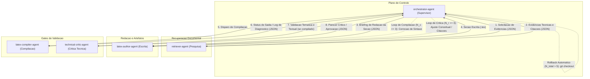

# Arquitetura Multi-Agente em Malha Fechada: Redação Acadêmica do Artigo sobre Federico Faggin e Intel 4004

---

## 1. Topologia de Orquestração e Mecânica de Loops

### Modelo de Interação
O sistema adota o padrão **Supervisor-Worker com Duplo Gate de Verificação** (*Compiler Gate* e *Critic-in-the-Loop*):
- O **Orchestrator** coordena o avanço sequencial do artigo por seções (`secoes/01_introducao.tex` até `secoes/06_conclusao.tex`).
- Cada seção passa por um ciclo fechado de pesquisa documental, redação técnica, compilação de código LaTeX e auditoria temática de física e história de semicondutores.
- Trabalhadores operam isolados e comunicam-se exclusivamente via envelopes JSON estruturados intermediados pelo Orchestrator.

### Diagrama de Topologia e Fluxo de Loops



### Governança de Loops e Critérios de Convergência

1. **Condição de Entrada:**
   - Árvore de trabalho limpa (`git status --porcelain` vazio).
   - Definição canônica do plano de seções em `utils/tema.md` e preâmbulo funcional em `00_config.tex`.
2. **Rubrica de Avaliação em 4 Níveis (Evaluation Gates):**
   - **Nível 1 (Compilação):** Execução limpa via `latexmk` sem erros fatais.
   - **Nível 2 (Integridade Referencial):** Ausência de referências não resolvidas (*undefined references*), chaves BibTeX órfãs ou arquivos ausentes em `img/`.
   - **Nível 3 (Rigor Físico e Histórico):** Aderência estrita à física de semicondutores (porta autoalinhada de silício, dopagem em polissilício, redução de capacitâncias parasitas de sobreposição $C_{gd}$ e $C_{gs}$, processo PMOS de canal p em silício monolítico) e precisão biográfica/histórica (papel de Federico Faggin na Fairchild e na Intel, equipe do MCS-4 com Hoff, Mazor e Shima, e a encomenda da Busicom).
   - **Nível 4 (Higiene de Diff):** Modificação restrita ao arquivo da seção em processamento (`secoes/XX_nome.tex`), sem mutações indevidas em arquivos globais.
3. **Critérios de Término e Rollback:**
   - **Teto Rígido de Iterações:** Máximo absoluto de 5 iterações totais ($N \le 5$) por seção.
   - **Detecção de Estagnação:** Se a mesma mensagem de erro de compilação ou mesma inconsistência conceitual persistir por 2 ciclos consecutivos sem redução no log de falhas, a iteração é interrompida.
   - **Comando de Rollback:** Em caso de estouro do limite ($N > 5$) ou estagnação:
     ```bash
     git checkout HEAD -- secoes/XX_secao_alvo.tex
     ```
     O supervisor congela o fluxo, gera um log estruturado da anomalia e solicita intervenção do operador humano.

---

## 2. Perfis de Especificação dos Agentes

### Agente 1: `orchestrator-agent`

| Parâmetro | Especificação |
| :--- | :--- |
| **Nome e Papel** | `orchestrator-agent`: Roteador central de mensagens, controle de estado do DAG e guardião dos contadores de iteração ($N \le 5$). |
| **Modelo Alvo** | `pro`: Alta capacidade de raciocínio para inferência de estados, arbitragem de conflitos e avaliação de conformidade. |
| **Permissões de Ferramentas** | **Allowlist:** `run_command` (apenas `git status`, `git checkout`, `git log`), `send_message`, `view_file`.<br>**Denylist:** `write_to_file`, `replace_file_content`, comandos shell destrutivos (`rm`, `git reset --hard`). |
| **Diretórios de Atuação** | **Leitura:** `utils/tema.md`, `main.tex`, `secoes/`.<br>**Escrita:** Nenhuma alteração direta em arquivos do artigo. |

#### Contratos de Interface (JSON)

**Entrada:**
```json
{
  "task": "orchestrate_section",
  "section_id": "02_fundamentacao",
  "target_file": "secoes/02_fundamentacao.tex",
  "iteration_count": 1
}
```

**Saída:**
```json
{
  "status": "in_progress",
  "current_stage": "authoring",
  "active_agent": "latex-author-agent",
  "iteration": 1,
  "payload": {
    "section_file": "secoes/02_fundamentacao.tex",
    "directives": ["Integrar analise comparativa de capacitancia parasita porta-dreno."]
  }
}
```

#### Diretiva de Sistema (Excerto)
> Você é o supervisor central do projeto. Jamais modifique arquivos `.tex` ou `.bib`. Monitore contadores de iteração por seção. Acione rollback se $N > 5$. Toda comunicação com os agentes subordinados deve ocorrer via envelopes JSON estruturados.

---

### Agente 2: `retriever-agent`

| Parâmetro | Especificação |
| :--- | :--- |
| **Nome e Papel** | `retriever-agent`: Especialista em recuperação e curadoria de fontes históricas e técnicas em microeletrônica. |
| **Modelo Alvo** | `flash`: Baixa latência e alta eficiência na extração e sumarização de conteúdos em múltiplos documentos. |
| **Permissões de Ferramentas** | **Allowlist:** `view_file`, `search-retriever`.<br>**Denylist:** `write_to_file`, `replace_file_content`, `run_command`. |
| **Diretórios de Atuação** | **Leitura:** `utils/docs/aulas/**`, `utils/docs/ref/**`, `utils/docs/search/**`, `pos_textuais/01_referencias.bib`.<br>**Escrita:** Nenhuma escrita permitida. |

#### Contratos de Interface (JSON)

**Entrada:**
```json
{
  "request_id": "req_02_sgt_physics",
  "query_topics": ["silicon_gate_technology", "parasitic_capacitance", "fairchild_3708"],
  "target_section": "02_fundamentacao.tex"
}
```

**Saída:**
```json
{
  "request_id": "req_02_sgt_physics",
  "findings": [
    {
      "topic": "Reducao de capacitancia parasita",
      "facts": "A porta autoalinhada substituiu o aluminio por polisilicio dopado, reduzindo a sobreposicao porta-dreno e eliminando capacitancias parasitas criticas.",
      "source_file": "utils/docs/aulas/aula4_era_eletronica.pdf",
      "bib_key": "faggin1970silicon"
    }
  ]
}
```

#### Diretiva de Sistema (Excerto)
> Extraia apenas evidências documentadas em `utils/`. Proibido inventar fontes, datas ou equações. Se a chave BibTeX não constar em `01_referencias.bib`, sinalize explicitamente como pendência para o supervisor.

---

### Agente 3: `latex-author-agent`

| Parâmetro | Especificação |
| :--- | :--- |
| **Nome e Papel** | `latex-author-agent`: Redator técnico responsável por compor prosa acadêmica contínua, equações e tabelas em LaTeX. |
| **Modelo Alvo** | `pro`: Raciocínio profundo para redação acadêmica coesa, sem clichês e com formalismo matemático adequado. |
| **Permissões de Ferramentas** | **Allowlist:** `view_file`, `replace_file_content`, `write_to_file`, skill `latex-writer`.<br>**Denylist:** `run_command` (bloqueado de compilar ou interagir com o terminal). |
| **Diretórios de Atuação** | **Leitura:** `00_config.tex`, `main.tex`, `utils/tema.md`.<br>**Escrita:** Estritamente `secoes/*.tex` e metadados de imagens em `img/`. |

#### Contratos de Interface (JSON)

**Entrada:**
```json
{
  "action": "draft_or_refine",
  "target_file": "secoes/02_fundamentacao.tex",
  "context_data": {
    "evidence": [],
    "review_feedback": []
  }
}
```

**Saída:**
```json
{
  "status": "written",
  "target_file": "secoes/02_fundamentacao.tex",
  "citations_used": ["faggin1970silicon", "intel1971mcs4"],
  "lines_modified": 45
}
```

#### Diretiva de Sistema (Excerto)
> Redija prosa acadêmica rigorosa, concisa e orientada aos dados em LaTeX. Não use travessões ou jargões corporativos. Restrinja as alterações ao arquivo da seção indicada. Nunca tente invocar comandos de terminal ou compiladores.

---

### Agente 4: `latex-compiler-agent`

| Parâmetro | Especificação |
| :--- | :--- |
| **Nome e Papel** | `latex-compiler-agent`: Verificador de compilação determinística, analisador de logs e sentinela de sintaxe LaTeX. |
| **Modelo Alvo** | `flash`: Análise rápida de logs de erro e extração imediata de códigos de saída. |
| **Permissões de Ferramentas** | **Allowlist:** `run_command` (restrito ao utilitário `latexmk`), `view_file`, skill `latex-build`.<br>**Denylist:** `write_to_file`, `replace_file_content`. |
| **Diretórios de Atuação** | **Leitura:** `main.tex`, `00_config.tex`, `secoes/*.tex`, `pos_textuais/*.bib`, `out/*.log`.<br>**Escrita:** `out/` (apenas artefatos gerados pelo compilador). |

#### Contratos de Interface (JSON)

**Entrada:**
```json
{
  "command": "build",
  "entrypoint": "main.tex",
  "clean_first": false
}
```

**Saída:**
```json
{
  "exit_code": 0,
  "compilation_success": true,
  "errors": [],
  "warnings": [
    {"type": "underfull_hbox", "line": 42, "file": "secoes/02_fundamentacao.tex"}
  ],
  "pdf_generated": "out/main.pdf"
}
```

#### Diretiva de Sistema (Excerto)
> Execute a compilação isolando todos os artefatos na pasta `out/`. Isole erros fatais e alertas de chaves não definidas. Retorne relatórios com linha e nome do arquivo exato para ação imediata de correção.

---

### Agente 5: `technical-critic-agent`

| Parâmetro | Especificação |
| :--- | :--- |
| **Nome e Papel** | `technical-critic-agent`: Revisor adversário de exatidão técnica, fidelidade histórica da microeletrônica e conformidade metodológica. |
| **Modelo Alvo** | `pro`: Crítica acadêmica rigorosa de conceitos físicos e consistência cruzada com as referências primárias. |
| **Permissões de Ferramentas** | **Allowlist:** `view_file`, skill `academic-review`.<br>**Denylist:** `write_to_file`, `replace_file_content`, `run_command`. |
| **Diretórios de Atuação** | **Leitura:** `secoes/*.tex`, `utils/tema.md`, `utils/docs/aulas/**`, `pos_textuais/01_referencias.bib`.<br>**Escrita:** Nenhuma alteração em arquivos. |

#### Contratos de Interface (JSON)

**Entrada:**
```json
{
  "action": "critique_section",
  "section_file": "secoes/02_fundamentacao.tex",
  "compiled_successfully": true
}
```

**Saída:**
```json
{
  "decision": "REJECT",
  "score": 7.5,
  "deficiencies": [
    {
      "severity": "CRITICAL",
      "category": "physics_accuracy",
      "issue": "A secao descreve a tecnologia SGT como NMOS, mas o Intel 4004 original utilizava processo PMOS com silicio policristalino.",
      "remediation": "Corrigir a mencao para processo PMOS de canal p em silicio e ajustar a polarizacao correspondente."
    }
  ],
  "can_proceed": false
}
```

#### Diretiva de Sistema (Excerto)
> Atue como revisor acadêmico sênior. Avalie com máximo rigor a fidelidade histórica e a física de dispositivos. Rejeite o texto se houver distorções de crédito entre Faggin, Hoff e Shima, ou imprecisões no processo de porta autoalinhada.

---

## 3. Especificação de Novas Skills Propostas

### Skill 1: `bib-validator`
- **Justificativa:** Garantir integridade referencial entre as citações empregadas no corpo do texto (`\cite{...}`) e as entradas cadastradas em `pos_textuais/01_referencias.bib`. Previne erros de compilação e referências quebradas antes de cada ciclo de entrega.
- **Entradas:** 
  - Caminho dos arquivos `.tex` em `secoes/`.
  - Caminho do arquivo `pos_textuais/01_referencias.bib`.
- **Saídas:**
  - Relatório JSON estruturado contendo: `missing_in_bib`, `unused_in_tex`, `syntax_valid` (boolean).
- **Ferramentas e Comandos Subjacentes:**
  - Script determinístico ou parser BibTeX em Python (`pybtex` ou script regex em shell) validando paridade de chaves.

### Skill 2: `academic-review`
- **Justificativa:** Prover ao `technical-critic-agent` uma rubrica automatizada de avaliação focada em escrita acadêmica, conformidade com a estrutura de `utils/tema.md` e regras de formatação do artigo modelo em `utils/docs/ref/`.
- **Entradas:**
  - Arquivo de seção sob revisão (`secoes/XX_nome.tex`).
  - Matriz de requisitos temáticos e diretrizes da Aula 4 (`utils/tema.md`).
- **Saídas:**
  - Relatório JSON com notas por critério (Fundamentação Física, Coesão Argumentativa, Estilo Hype-Free, Aderência Estrutural) e lista de correções acionáveis.
- **Ferramentas e Comandos Subjacentes:**
  - Mecanismo de prompt estruturado com análise comparativa e restrições negativas rígidas.

---

## 4. Blueprint de Integração ao Sistema (.gemini/GEMINI.md e Hooks)

### Scaffolding para `.gemini/GEMINI.md`

```markdown
# Politica de Orquestracao Multi-Agente: Artigo Intel 4004 & Faggin

## 1. Registro e Papeis de Agentes
- orchestrator-agent: Coordenador do fluxo e controle de estado do DAG. (Modelo: pro)
- retriever-agent: Consulta documental e busca de evidencias tecnicas. (Modelo: flash)
- latex-author-agent: Redacao das secoes em LaTeX. (Modelo: pro)
- latex-compiler-agent: Compilacao isolada e analise de logs em out/. (Modelo: flash)
- technical-critic-agent: Auditor de fisica de dispositivos e precisao historica. (Modelo: pro)

## 2. Isolamento de Permissoes
- Escrita em secoes/*.tex: Permitida exclusivamente ao latex-author-agent.
- Execucao de comandos de compilacao: Permitida exclusivamente ao latex-compiler-agent.
- Operacoes de rollback git: Restritas ao orchestrator-agent.
- Leituras documentais em utils/**: Acesso liberado para retriever-agent e technical-critic-agent.

## 3. Orcamento e Limites Operacionais
- Limite maximo de iteracoes por secao: N <= 5.
- Interrupcao automatica: Disparada ao detectar estagnacao em 2 ciclos consecutivos.
- Formato de comunicacao inter-agente: Envelopes JSON estritos.
```

### Hooks de Ciclo de Vida e Segurança

```
.gemini/
├── GEMINI.md
└── hooks/
    ├── pre-task-audit.sh         # Valida se a working tree do git esta limpa antes do ciclo
    ├── post-write-compile.sh     # Dispara o latex-compiler-agent logo apos edicao em secoes/
    └── boundary-guard.sh         # Bloqueia modificacoes fora do escopo da secao ativa
```

1. **Pre-Task Hook (`pre-task-audit.sh`):**
   - Disparo: Antes de iniciar o ciclo de uma nova seção.
   - Ação: Executa `git status --porcelain`. Interrompe a execução caso existam arquivos modificados não comitados.
2. **Post-Write Hook (`post-write-compile.sh`):**
   - Disparo: Imediatamente após `latex-author-agent` concluir a alteração de um arquivo em `secoes/`.
   - Ação: Invoca `latexmk -pdf -outdir=out main.tex` em modo não-interativo e disponibiliza o log resultante.
3. **Boundary Guard Hook (`boundary-guard.sh`):**
   - Disparo: Durante qualquer operação de escrita em arquivo.
   - Ação: Rejeita alterações que modifiquem simultaneamente múltiplos arquivos ou que afetem `00_config.tex` sem aprovação prévia do supervisor.

---

## 5. Mapeamento de Diretórios e Restrições Negativas Globais

### Mapeamento Direto por Agente

| Agente | Arquivos de Leitura | Arquivos de Escrita |
| :--- | :--- | :--- |
| `orchestrator-agent` | `utils/tema.md`, `main.tex`, `secoes/*.tex` | Nenhum (apenas comandos de reversão git) |
| `retriever-agent` | `utils/docs/aulas/**`, `utils/docs/ref/**`, `utils/docs/search/**`, `pos_textuais/*.bib` | Nenhum |
| `latex-author-agent` | `00_config.tex`, `main.tex`, `utils/tema.md` | Estritamente `secoes/*.tex` e `img/*` |
| `latex-compiler-agent` | `main.tex`, `00_config.tex`, `secoes/*.tex`, `pos_textuais/*.bib` | Estritamente `out/*` |
| `technical-critic-agent` | `secoes/*.tex`, `utils/tema.md`, `utils/docs/aulas/**` | Nenhum |

### Restrições Negativas Globais
- É vedada a criação de agentes com atribuições redundantes ou compartilhadas na mesma etapa de escrita.
- Nenhuma alteração estrutural na hierarquia de pastas do projeto (`secoes/`, `pos_textuais/`, `img/`, `utils/`) pode ser realizada.
- Toda modificação de texto em `.tex` deve ser sucedida imediatamente pela compilação correspondente via `latex-compiler-agent`.
- Fica proibido avançar para a seção seguinte do artigo sem aprovação explícita (`decision: "APPROVE"`) do `technical-critic-agent`.
